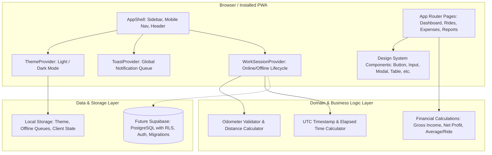

# RideLedger — Architecture Specification

## 1. System Overview

RideLedger is built as a high-performance Progressive Web Application (PWA) tailored for individual Rapido Captains to record work sessions, track daily rides and expenses, manage odometer readings, and analyze net profit.

---

## 2. Layered Architecture

### A. Presentation Layer (`src/components/`, `src/app/`)
- **Next.js 15 App Router**: Modern React Server and Client Components. Provides instant, zero-reload transitions between views.
- **Design System (`src/components/ui/`)**: Atomic, reusable, fully accessible primitives:
  - `Button`, `Input`, `Select`, `Card`, `Badge`, `Modal`, `ConfirmationDialog`, `Toast`, `Table`, `ChartContainer`, `LoadingState`, `EmptyState`.
- **Application Shells (`src/components/layout/`)**:
  - `AppShell`: Coordinates desktop and mobile views.
  - `DesktopSidebar`: Fixed/collapsible navigation with brand logos (`v5` expanded, `v4` collapsed).
  - `MobileNav`: Fixed bottom tab bar designed for one-handed operation on motorcycles.
  - `Header`: Route title, live online/offline indicator, and theme switcher.

### B. Theming Architecture
- Driven by CSS variables in `src/styles/globals.css`.
- Synchronized by `ThemeProvider` (`src/context/theme-context.tsx`).
- Stores selection in `localStorage` under key `rideledger-theme`.
- Reacts to OS dark/light mode preference (`prefers-color-scheme`) when set to `system`.
- Transitions instantaneously with zero page reloads and zero CSS flash.

### C. Domain & Calculations Layer (`src/lib/calculations.ts`, `src/lib/odometer.ts`)
- **Financial Calculations**:
  - Gross Income = `ride earnings + incentives + tips`
  - Net Profit = `gross income - recorded expenses`
  - Income Per Online Hour = `gross income / online session hours` (guarded against division by zero)
- **Odometer & Mileage**:
  - Distance = `ending odometer - starting odometer`
  - Strict validation: `ending_odometer >= starting_odometer`
- **Work Session State Machine**:
  `Offline` -> `Starting` (Odometer entry) -> `Online` (Active session & timer) -> `Ending` (Closing odometer) -> `Saved`.

### D. Data & Persistence Layer
- Phase 1 initializes the client state providers and contracts.
- Future phases bind to PostgreSQL / Supabase with Row Level Security (RLS) enforcing strict user-ownership of ride and expense records.

---

## 3. Performance & Accessibility Standards
- **Zero Page Reloads**: Client-side navigation via `next/link`.
- **Zero Horizontal Overflow**: Guaranteed across all screen sizes down to 320px mobile viewports (`overflow-x-hidden`, responsive tables with mobile card view).
- **Accessible Focus Management**: Modals feature keyboard trap, `Escape` key close, and visible focus rings (`focus-visible:ring-2`).
- **Touch Ergonomics**: All interactive elements satisfy minimum 44px touch targets.
