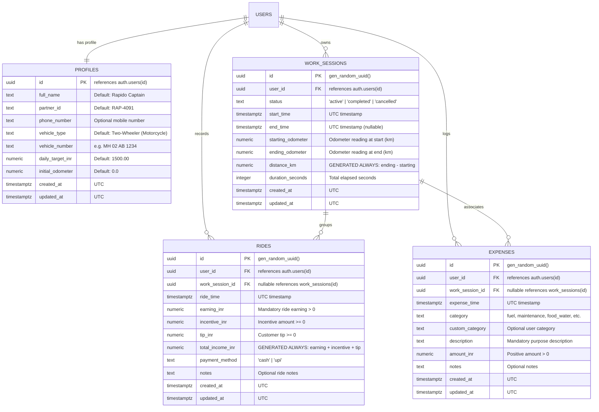

# RideLedger — Database Schema & Data Architecture

## 1. Entity-Relationship Overview



---

## 2. Table Specifications

### A. `profiles`
Stores the authenticated Captain's profile and operational configurations.

| Column | Type | Constraints | Description |
|---|---|---|---|
| `id` | `UUID` | `PRIMARY KEY REFERENCES auth.users(id) ON DELETE CASCADE` | Matches the Supabase Auth user ID. |
| `full_name` | `TEXT` | `NOT NULL DEFAULT 'Rapido Captain'` | Captain display name. |
| `partner_id` | `TEXT` | `NOT NULL DEFAULT 'RAP-4091'` | Rapido Captain partner ID. |
| `phone_number` | `TEXT` | `NULL` | Registered mobile contact. |
| `vehicle_type` | `TEXT` | `NOT NULL DEFAULT 'Two-Wheeler (Motorcycle)'` | Vehicle category. |
| `vehicle_number` | `TEXT` | `NULL` | Vehicle license plate number. |
| `daily_target_inr`| `NUMERIC(10,2)`| `NOT NULL DEFAULT 1500.00 CHECK (daily_target_inr >= 0)` | Goal target for daily earnings. |
| `initial_odometer`| `NUMERIC(10,1)`| `NOT NULL DEFAULT 0.0 CHECK (initial_odometer >= 0)` | Base starting odometer reading. |
| `created_at` | `TIMESTAMPTZ` | `NOT NULL DEFAULT timezone('utc', now())` | Creation timestamp. |
| `updated_at` | `TIMESTAMPTZ` | `NOT NULL DEFAULT timezone('utc', now())` | Last update timestamp. |

### B. `work_sessions`
Manages the work session lifecycle and odometer readings.

| Column | Type | Constraints | Description |
|---|---|---|---|
| `id` | `UUID` | `PRIMARY KEY DEFAULT gen_random_uuid()` | Unique session identifier. |
| `user_id` | `UUID` | `NOT NULL REFERENCES auth.users(id) ON DELETE CASCADE` | Owning Captain user ID. |
| `status` | `TEXT` | `NOT NULL CHECK (status IN ('active', 'completed', 'cancelled'))` | Current session state. |
| `start_time` | `TIMESTAMPTZ` | `NOT NULL DEFAULT timezone('utc', now())` | Session commencement UTC. |
| `end_time` | `TIMESTAMPTZ` | `NULL` | Session conclusion UTC. |
| `starting_odometer` | `NUMERIC(10,1)` | `NOT NULL CHECK (starting_odometer >= 0)` | Odometer at session start (km). |
| `ending_odometer` | `NUMERIC(10,1)` | `CHECK (ending_odometer >= starting_odometer)` | Odometer at session end (km). |
| `distance_km` | `NUMERIC(10,1)` | `GENERATED ALWAYS AS (...) STORED` | Net distance travelled. |
| `duration_seconds` | `INTEGER` | `CHECK (duration_seconds IS NULL OR duration_seconds >= 0)` | Net online seconds. |

**Indexes & Invariants:**
- `idx_work_sessions_single_active`: Partial unique index `(user_id) WHERE (status = 'active')`. Guarantees at most 1 active session per user.
- `idx_work_sessions_user_time`: Index `(user_id, start_time DESC)` for timeline queries.

### C. `rides`
Stores individual ride records with earnings, incentives, and tips.

| Column | Type | Constraints | Description |
|---|---|---|---|
| `id` | `UUID` | `PRIMARY KEY DEFAULT gen_random_uuid()` | Stable unique ride ID. |
| `user_id` | `UUID` | `NOT NULL REFERENCES auth.users(id) ON DELETE CASCADE` | Owning Captain user ID. |
| `work_session_id` | `UUID` | `REFERENCES work_sessions(id) ON DELETE SET NULL` | Parent active session. |
| `ride_time` | `TIMESTAMPTZ` | `NOT NULL DEFAULT timezone('utc', now())` | Timestamp of the trip. |
| `earning_inr` | `NUMERIC(10,2)` | `NOT NULL CHECK (earning_inr > 0)` | Base ride fare in INR. |
| `incentive_inr` | `NUMERIC(10,2)` | `NOT NULL DEFAULT 0.00 CHECK (incentive_inr >= 0)` | Peak/platform incentive. |
| `tip_inr` | `NUMERIC(10,2)` | `NOT NULL DEFAULT 0.00 CHECK (tip_inr >= 0)` | Customer tip. |
| `total_income_inr`| `NUMERIC(10,2)` | `GENERATED ALWAYS AS (earning + incentive + tip) STORED` | Gross total income. |
| `payment_method` | `TEXT` | `NOT NULL CHECK (payment_method IN ('cash', 'upi'))` | Cash or UPI. |
| `notes` | `TEXT` | `NULL` | Optional ride notes. |

### D. `expenses`
Records operating expenses incurred during driving shifts.

| Column | Type | Constraints | Description |
|---|---|---|---|
| `id` | `UUID` | `PRIMARY KEY DEFAULT gen_random_uuid()` | Stable unique expense ID. |
| `user_id` | `UUID` | `NOT NULL REFERENCES auth.users(id) ON DELETE CASCADE` | Owning Captain user ID. |
| `work_session_id` | `UUID` | `REFERENCES work_sessions(id) ON DELETE SET NULL` | Associated session (optional). |
| `expense_time` | `TIMESTAMPTZ` | `NOT NULL DEFAULT timezone('utc', now())` | Timestamp of expenditure. |
| `category` | `TEXT` | `NOT NULL CHECK (category IN ('fuel', 'maintenance', ...))` | Standardized category. |
| `custom_category` | `TEXT` | `NULL` | Custom category if 'other'. |
| `description` | `TEXT` | `NOT NULL` | Description of expense. |
| `amount_inr` | `NUMERIC(10,2)` | `NOT NULL CHECK (amount_inr > 0)` | Total expenditure in INR. |

---

## 3. Row Level Security (RLS) Matrix

Every table enforces Row Level Security:

| Table | SELECT Policy | INSERT Policy | UPDATE Policy | DELETE Policy |
|---|---|---|---|---|
| `profiles` | `auth.uid() = id` | `auth.uid() = id` | `auth.uid() = id` | Denied |
| `work_sessions` | `auth.uid() = user_id` | `auth.uid() = user_id` | `auth.uid() = user_id` | `auth.uid() = user_id` |
| `rides` | `auth.uid() = user_id` | `auth.uid() = user_id` | `auth.uid() = user_id` | `auth.uid() = user_id` |
| `expenses` | `auth.uid() = user_id` | `auth.uid() = user_id` | `auth.uid() = user_id` | `auth.uid() = user_id` |

---

## 4. Migration Guide

1. **Local Setup with Supabase CLI**:
   ```bash
   npx supabase db reset
   ```
2. **Production Deployment**:
   Apply migrations sequentially using the Supabase Dashboard SQL Editor or CI/CD runner:
   - `supabase/migrations/20261014000001_initial_schema.sql`
